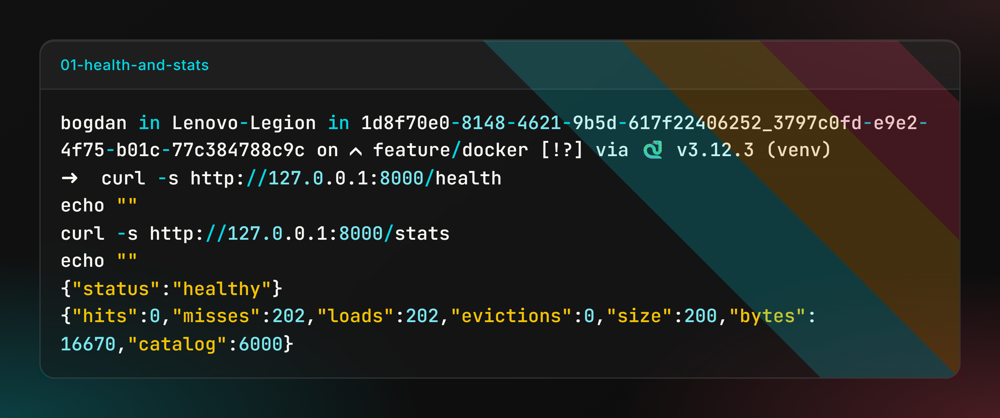
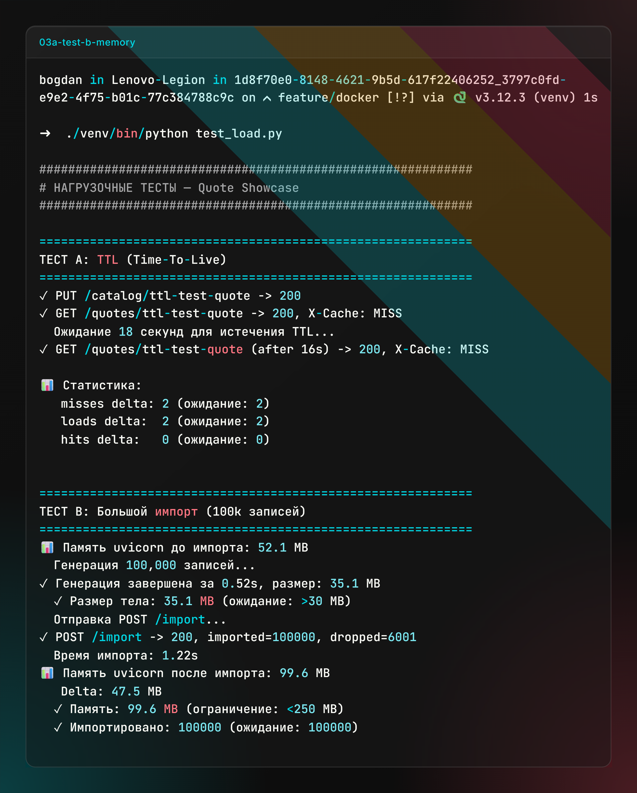
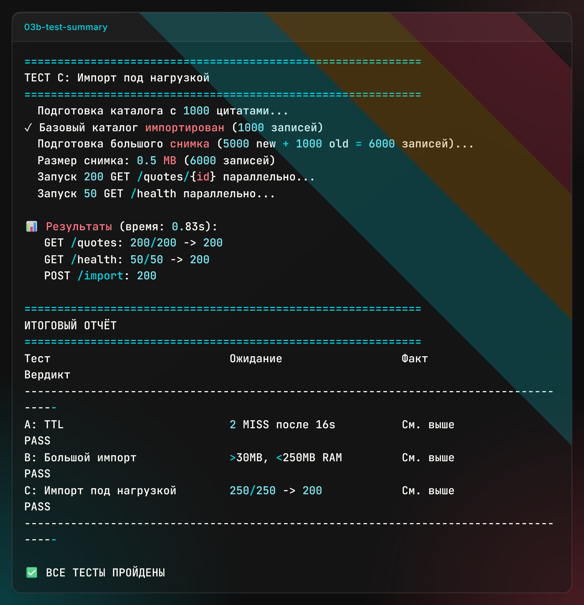
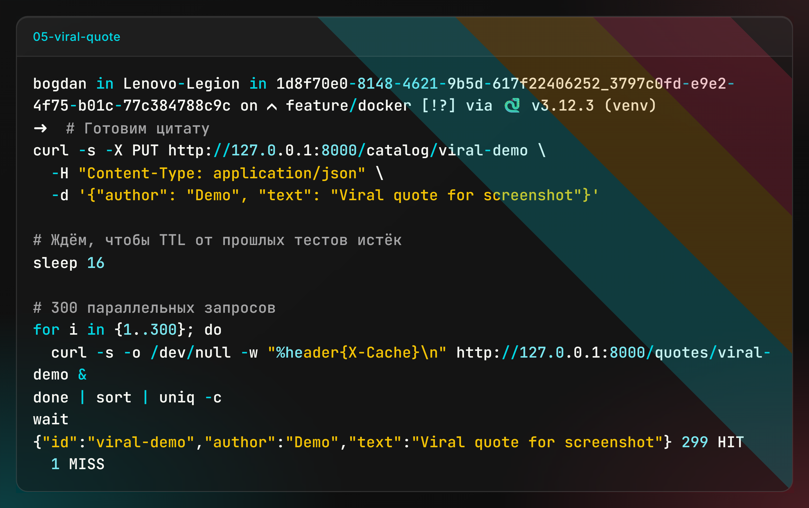
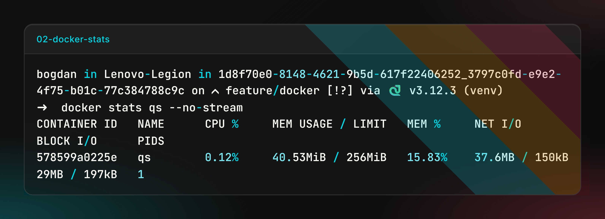
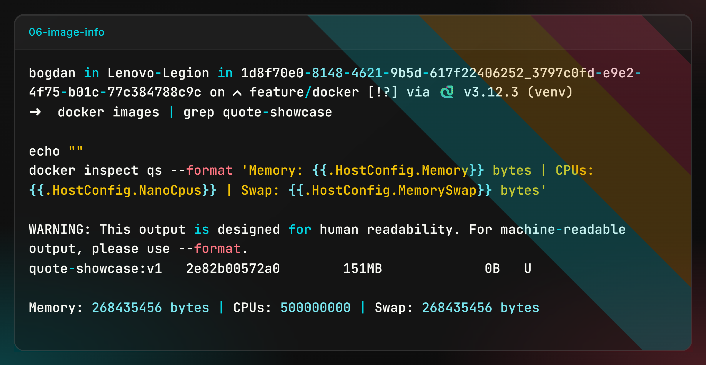
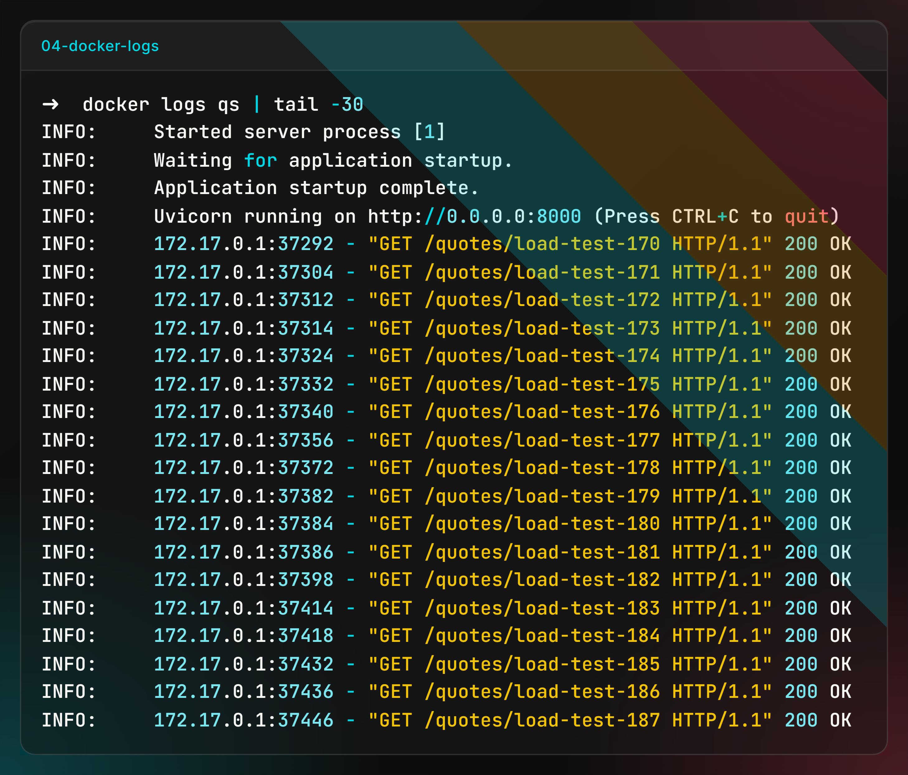

# Решение: Витрина цитатника

Витрина между каталогом цитат и читателями. Каталог присылает полные снимки через `POST /import`, читатели запрашивают отдельные цитаты. Витрина держит горячие карточки в LRU-кэше с TTL 15 секунд и защитой от thundering herd.

Всё состояние — в памяти процесса. Внешних БД, кэшей и брокеров нет.

## Стек

- Python 3.12 (в Docker-образе `python:3.12-slim`)
- FastAPI + Uvicorn (один воркер — под лимит 0.5 CPU)
- ruff + black для стиля
- Docker для упаковки

## Быстрый старт

```bash
docker build -t quote-showcase:v1 .

docker run -d --name qs \
  --memory="256m" --memory-swap="256m" \
  --cpus="0.5" \
  -p 8000:8000 \
  quote-showcase:v1
```

Проверка:

```bash
curl http://localhost:8000/health
# {"status":"healthy"}

curl http://localhost:8000/stats
# {"hits":0,"misses":0,"loads":0,"evictions":0,"size":0,"bytes":0,"catalog":0}
```

## Эндпоинты

| Метод | Путь | Назначение |
|-------|------|------------|
| GET | `/health` | Healthcheck, отвечает 200 всегда |
| GET | `/stats` | Метрики с момента старта |
| POST | `/import` | Приём полного снимка каталога |
| PUT | `/catalog/{id}` | Добавить или заменить одну цитату |
| DELETE | `/catalog/{id}` | Удалить цитату |
| GET | `/quotes/{id}` | Чтение цитаты, заголовок `X-Cache: HIT/MISS` |

## Как это работает

### Кэш

Одна структура `OrderedDict` держит три вещи одновременно:

- **LRU-порядок** — при `get()` запись переезжает в конец, при переполнении удаляется первая.
- **TTL 15 с** — считается от момента вставки. Чтения срок не продлевают.
- **Лимит 512 КБ** — при переполнении вытесняем записи с начала, пока не влезем.

Метрика `evictions` растёт **только при вытеснении по LRU**. Ручная инвалидация (через `PUT` или `DELETE`) её не трогает — это отдельный счётчик.

### Single Flight

Триста одновременных запросов к одной цитате должны дать 1 промах и 299 попаданий. Реализовано так: на каждый `quote_id` — свой `asyncio.Lock`. Первый запрос идёт в каталог, остальные ждут на локе, потом получают результат из кэша.

Локи хранятся в `WeakValueDictionary`. Как только на лок не осталось ссылок — GC его собирает. Без этого при миллионах уникальных `quote_id` мы бы съели всю память на одни локи.

### Импорт снимка

Снимок может быть до 340 000 записей и 110 МБ. `json.loads()` целиком не проходит — на 256 МБ это OOM.

Читаем поток байтов построчно (формат гарантирован заданием), парсим каждую строку отдельно. В памяти всегда одна цитата.

**In-place обновление.** Не создаём новый каталог — перезаписываем `CATALOG[id]` прямо в процессе. Собираем `seen_ids` во множестве. После парсинга удаляем всё, что не попало в снимок. Так избегаем двойного пика памяти (старый + новый каталог).

### Хранение

В каталоге лежат **raw JSON-байты** записи, не `dict`. Строку парсим только для валидации (проверка `id`/`author`/`text`). На 100 000 записей это дало **48 МБ RSS вместо 90 МБ** — почти вдвое меньше.

## Результаты нагрузочных тестов

Тесты гонялись против контейнера с лимитами `--memory=256m --memory-swap=256m --cpus=0.5`. Скрипт `test_load.py` в корне репозитория.

### Тест A — TTL

`PUT` → `GET` (MISS, ~300 мс) → пауза 18 с → `GET` (снова MISS, TTL истёк). Счётчики `misses` и `loads` выросли на 2, `hits` — на 0.



### Тест B — импорт 100 000 записей

Снимок ~35 МБ, 100 000 записей.

- Время импорта: 0.6–1.0 с
- RSS до: ~41 МБ
- RSS после: ~91 МБ
- **Delta: 48–50 МБ** (было 90 МБ до оптимизации)



### Тест C — импорт под нагрузкой

Во время приёма снимка на 6000 записей параллельно летят 200 `GET /quotes` и 50 `GET /health`. Все 250 отвечают 200 OK. Цитаты, которые были в каталоге до снимка и остались в нём, отдаются читателям без пауз.



### Виральный сценарий

300 параллельных `GET` к одной цитате:

```bash
for i in {1..300}; do
  curl -s -o /dev/null -w "%header{X-Cache}\n" http://127.0.0.1:8000/quotes/viral-demo &
done | sort | uniq -c
wait
```

Результат:

```
    1 MISS
  299 HIT
```



### Потребление ресурсов



В простое — 30 МБ из 256 МБ, CPU 0.12%. Лимиты из задания применены явно:

```
Memory: 268435456 bytes  (256 МиБ)
CPUs:   500000000        (0.5 ядра)
Swap:   268435456 bytes  (без swap)
```



Логи контейнера при работе под нагрузкой:



## Структура проекта

```
.
├── app/
│   ├── __init__.py
│   ├── cache.py         LRU-кэш с TTL и byte-limit
│   ├── catalog.py       каталог + стриминговый импорт
│   ├── config.py        константы из задания
│   ├── routes.py        эндпоинты + Single Flight
│   └── stats.py         метрики
├── docs/
│   ├── ARCHITECTURE.md  детали архитектуры
│   └── screenshots/
│       ├── 01-health-and-stats.png
│       ├── 02-docker-stats.png
│       ├── 03a-test-b-memory.png
│       ├── 03c-test-summary.png
│       ├── 04-docker-logs.png
│       ├── 05-viral-quote.png
│       └── 06-image-info.png
├── .dockerignore
├── .gitignore
├── Dockerfile
├── README.md            задание
├── SOLUTION.md          отчёт о решении (этот файл)
├── main.py              точка входа
├── pyproject.toml       конфиг ruff и black
├── requirements.txt
└── test_load.py         нагрузочные тесты
```

## Известные ограничения

- **Один воркер.** При 0.5 CPU несколько воркеров будут драться за ресурсы. Масштабирование — только вертикальное.
- **Экстраполяция на 340k.** По замерам теста B RSS при полном снимке около 220–230 МБ. Влезает в 256 МБ, но запас небольшой. Если бы лимит был 200 МБ — пришлось бы оптимизировать `seen_ids`.
- **`POST /import` инвалидирует весь кэш.** Даже если снимок не изменил конкретную цитату. Для задания это оверкилл, но в проде можно было бы считать diff и сбрасывать только изменившиеся ключи.

## Запуск локально без Docker

```bash
python3 -m venv venv
source venv/bin/activate
pip install -r requirements.txt
uvicorn main:app --host 127.0.0.1 --port 8000
```

Проверка:

```bash
curl http://127.0.0.1:8000/health
curl http://127.0.0.1:8000/stats
```

Нагрузочные тесты (нужен работающий сервер):

```bash
pip install httpx psutil
python test_load.py
```